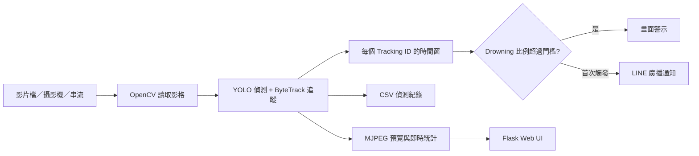

<<<<<<< HEAD
# 模組化溺水偵測系統

這是一套以 Ultralytics You Only Look Once (YOLO)、ByteTrack、OpenCV、Flask 與
LINE Messaging Application Programming Interface (API) 組成的溺水偵測示範系統。
程式可處理上傳影片或 OpenCV 可讀取的即時串流，追蹤畫面中的人物狀態，依一段時間
內 `Drowning` 分類的比例判斷是否發出警示。系統包含瀏覽器操作介面、Motion JPEG
(MJPEG) 即時畫面、comma-separated values (CSV) 偵測紀錄與選用的 LINE 廣播通知。

原本集中在 `v14_linebot_message.ipynb` 的程式已依功能拆成 9 個 notebooks，並以
`main.ipynb` 作為唯一建議入口。所有功能 notebook 透過 `%run -i` 共用同一個
IPython 命名空間，因此請依主程式順序執行，不建議任意跳過或調換模組。

> [!WARNING]
> 本專案是電腦視覺研究／展示工具，不是經認證的水域安全設備，也不能取代救生員、
> 現場監控、緊急通報或人工判斷。模型可能誤報或漏報，請勿將它作為唯一安全機制。

## 主要功能

- 載入自訂 YOLO 權重 `best.pt`，自動選用 CUDA GPU 或 CPU。
- 辨識 `Drowning`、`Person out of water`、`Swimming` 三個類別。
- 使用 ByteTrack 取得 Tracking ID，並維護每個追蹤目標的歷史分類。
- 支援上傳影片、Real-Time Streaming Protocol (RTSP)／Hypertext Transfer Protocol
  (HTTP) 串流，以及執行主機可存取的攝影機編號。
- 在影像上繪製 YOLO 結果、FPS、累計偵測數、有效警示與警示總數。
- 透過時間窗與溺水比例降低單一影格誤判造成的警示。
- 提供開始、暫停、繼續、停止、上傳進度及參數調整介面。
- 產生 UTF-8 BOM CSV 紀錄，處理結束後可由頁面下載。
- 可選擇使用 LINE Channel Access Token 發送首次警示與測試訊息。
- 支援 Colab；Kaggle 輸入資料會自動複製到可寫的工作目錄。

## 系統流程



## 專案結構

| 檔案 | 說明 |
| --- | --- |
| `main.ipynb` | 主程式入口；準備 Colab／Kaggle 執行目錄、依序載入模組並啟動 Flask。 |
| `00_environment.ipynb` | 安裝 Flask、Ultralytics、OpenCV headless 與 LINE Bot SDK。 |
| `01_model_setup.ipynb` | 尋找或下載 `best.pt`、建立 ByteTrack YAML、選擇 CUDA／CPU 並載入模型。 |
| `02_state_and_utils.ipynb` | 建立 Flask app、執行狀態、共用常數、黑色預設畫面及影片工具函式。 |
| `03_visualization.ipynb` | 定義統計面板與 `POSSIBLE DROWNING` 警示橫幅。 |
| `04_line_notification.ipynb` | 以背景執行緒送出 LINE 文字廣播，避免阻塞影像處理。 |
| `05_detection_engine.ipynb` | YOLO 追蹤、警示演算法、影像標註、統計及 CSV 寫入的主迴圈。 |
| `06_web_api.ipynb` | Flask 首頁、串流、狀態、上傳、控制、下載及 LINE 測試 API。 |
| `07_web_ui.ipynb` | HTML、CSS 與 JavaScript Web 操作介面。 |
| `08_server.ipynb` | 檢查連接埠、背景啟動 Flask，並處理 Colab／Kaggle／一般 Jupyter 顯示方式。 |
| `best.pt` | YOLO 模型權重，約 19 MB；目前檔案 SHA-256 為 `0C26E8586C34EC90C6BAC8D9BD7A3BBF38964AE84688DD908154877EE61AC2F5`。 |
| `v14_linebot_message.ipynb` | 拆分前的原始版本，保留作為來源及比對用途。 |
| `build_modular_notebooks.py` | 從原始 notebook 擷取函式並重新產生 `00`～`08` 與 `main.ipynb`。不會覆寫本 README。 |
| `.ipynb_checkpoints/train-checkpoint.ipynb` | 歷史訓練草稿：在 Colab 解壓資料集、檢查 `data.yaml`、以 YOLO11s 訓練並下載權重；不參與正式推論流程。 |
| `.ipynb_checkpoints/v14_linebot_message-checkpoint.ipynb` | 原始整合 notebook 的 Jupyter 自動檢查點，不參與正式執行流程。 |

執行時還會建立下列檔案：

| 檔案 | 產生時機與內容 |
| --- | --- |
| `custom_bytetrack.yaml` | 每次載入模型時產生的 ByteTrack 設定。 |
| `uploaded_video.mp4` | Web UI 上傳的影片；下一次上傳會覆寫。 |
| `detection_log.csv` | 每次開始偵測時重建的原始紀錄；頁面下載時會使用帶時間戳的檔名。 |

## 執行需求

- Python 3 與可執行 notebook magic 的 IPython／Jupyter 環境。
- 建議使用 NVIDIA GPU；沒有 CUDA 時仍可使用 CPU，但推論速度會較慢。
- 第一次安裝套件或自動下載模型時需要網路。
- 所需主要套件由 `00_environment.ipynb` 安裝：
  - `flask>=3,<4`
  - `ultralytics>=8,<9`
  - `opencv-python-headless`
  - `line-bot-sdk>=3,<4`
- 若要使用 LINE 通知，需要可使用 broadcast API 的 LINE Messaging API
  Channel Access Token。

## 快速開始

### Google Colab

1. 建立 GPU 執行階段（建議但非必要）。
2. 將 `main.ipynb`、`00`～`08` notebooks 與 `best.pt` 放在同一目錄。
3. 開啟 `main.ipynb`，選擇「執行階段 → 全部執行」。
4. 套件、模型與模組載入完成後，最後一個 cell 會啟動 port `5000`，並透過
   Colab 的 kernel port proxy 開啟 Web UI。

若未提供 `best.pt`，程式會從
[原始 GitHub 專案的模型檔](https://github.com/jonwang5150/drowning_detection/raw/refs/heads/main/best.pt)
下載。

### Kaggle

1. 將本專案整個資料夾建立為 Kaggle Dataset，並加入 Notebook 的 Input。
2. 將 `main.ipynb` 匯入 Kaggle；第一次安裝套件或下載模型時請開啟 Internet。
3. 選擇「Run All」。主程式會搜尋 `/kaggle/input`，將模組與模型複製到：

   ```text
   /kaggle/working/drowning_detection
   ```

4. Kaggle 原生 Notebook 編輯器不會直接公開任意 Flask 連接埠。若要操作 Web UI，
   請使用「Run → Kaggle Jupyter Server → Open in Colab」，以 Colab 前端連接同一個
   Kaggle 後端，再重新執行啟動伺服器的 cell。

### 本機 Jupyter

1. 安裝並啟動 Jupyter Notebook 或 JupyterLab。
2. 讓終端機目前目錄位於本專案根目錄。
3. 開啟 `main.ipynb` 並執行全部 cells。
4. 一般 Jupyter 環境會顯示 `/proxy/5000/` 連結；若環境沒有 notebook port
   proxy，請使用平台的 Web Preview，或從同一台電腦開啟 `http://127.0.0.1:5000`。

若 port `5000` 已被占用，可修改 `main.ipynb` 最後一格：

```python
launch_server(port=5001)
```

## Web UI 使用方式

1. 選擇資料來源：
   - **上傳影片**：選擇影片後按上傳，完成後會先顯示第一個影格。
   - **視訊串流**：輸入 RTSP／HTTP URL，或輸入攝影機編號，例如 `0`。
2. 視需要調整偵測信心度與警示參數。
3. 如需 LINE 通知，勾選通知、輸入 Token，並先按測試按鈕確認連線。
4. 按「開始處理」。處理期間參數會鎖定，可暫停、繼續或停止。
5. 處理結束或停止後，使用「下載偵測紀錄」取得 CSV。

> [!NOTE]
> 在 Colab 或 Kaggle 等雲端環境輸入攝影機編號 `0`，代表的是遠端執行主機的攝影機，
> 不是瀏覽器所在電腦的 Webcam。雲端使用時通常應提供執行主機可連線的 RTSP／HTTP
> 串流，或直接上傳影片。

## 偵測與警示參數

| UI 參數 | Form 欄位 | 預設值 | 可調範圍 | 用途 |
| --- | --- | ---: | ---: | --- |
| 偵測信心度 | `conf_threshold` | `0.25` | `0.05`～`0.95`，step `0.01` | 傳給 YOLO 的最低信心度。 |
| Drowning 比例門檻 | `warning_ratio` | `0.60` | `0.10`～`1.00`，step `0.05` | 時間窗內 `Drowning` 比例必須**大於**此值才觸發。 |
| 警示時間窗 | `warning_window_sec` | `5.0` 秒 | `1`～`10` 秒，step `0.5` | 每個 Tracking ID 保留分類歷史的目標長度。 |
| 最低觀察比例 | `min_ratio_of_window` | `0.30` | `0.05`～`1.00`，step `0.05` | 至少累積多少比例的時間窗樣本後才允許判斷。 |

實際計算方式：

```text
時間窗影格數 = round(警示時間窗秒數 × 影片 FPS)
最低樣本數   = round(時間窗影格數 × 最低觀察比例)
溺水比例     = 該 Tracking ID 歷史中的 Drowning 次數 ÷ 已累積樣本數
觸發條件     = 已累積樣本數達標，且溺水比例 > Drowning 比例門檻
```

每個 Tracking ID 在一次處理工作中只會於**首次觸發**時增加警示總數並發送一次 LINE
通知；只要當前比例仍超過門檻，畫面上的紅框與警示橫幅會保持顯示。

介面顯示的三種類別計數是每一影格偵測框的**累計次數**，不是不重複人數。

## 模型與 ByteTrack 設定

模型預期包含以下類別名稱，名稱需與程式完全一致：

| 類別 ID | 類別名稱 | 用途 |
| ---: | --- | --- |
| `0` | `Drowning` | 納入溺水比例與警示判定。 |
| `1` | `Person out of water` | 統計及顯示。 |
| `2` | `Swimming` | 統計及顯示。 |

`01_model_setup.ipynb` 會建立以下 ByteTrack 設定：

| 設定 | 值 |
| --- | ---: |
| `tracker_type` | `bytetrack` |
| `track_high_thresh` | `0.25` |
| `track_low_thresh` | `0.10` |
| `new_track_thresh` | `0.25` |
| `track_buffer` | `150` |
| `match_thresh` | `0.80` |
| `fuse_score` | `True` |

若替換 `best.pt`，請確認新模型的類別名稱仍與 `TARGET_CLASSES` 相符；否則統計與
警示判定可能無法正常工作。

### 歷史訓練草稿

`.ipynb_checkpoints/train-checkpoint.ipynb` 留有模型訓練流程的歷史紀錄：它在 Colab
解壓 `Swimming and Drowning Detection.zip`、讀取 `/content/dataset/data.yaml`，以
Ultralytics 的 `yolo11s.pt` 作為起始模型，設定 `epochs=30`、`imgsz=640`、
`batch=16`、`device=0`，最後下載訓練輸出的 `best.pt`。這是 Jupyter checkpoint，
並非目前 `main.ipynb` 會呼叫的正式訓練管線；若要重現模型，仍需另行確認原始資料集、
資料切分、Ultralytics 版本、隨機種子與訓練輸出是否與目前權重一致。

## LINE 通知

LINE 功能使用 Channel Access Token 建立 `LineBotApi`，並呼叫 broadcast API。

- 「測試 LINE」會立即向該官方帳號的廣播對象送出測試訊息。
- 警示訊息包含影片／系統時間、影格編號及首次觸發的 Tracking ID。
- 發送在 daemon thread 中執行，不會等待 LINE 回應後才繼續處理影像。
- Token 僅保存在目前 Python 執行階段的記憶體與瀏覽器表單，不應寫入 notebook、
  README、截圖、公開 Dataset 或版本控制。
- broadcast 可能受 LINE 方案、好友狀態、權限及訊息額度限制，並可能向多名使用者
  發送。正式使用前請先確認官方帳號設定與接收範圍。

## Web API

| Method | 路徑 | 功能 |
| --- | --- | --- |
| `GET` | `/` | 回傳 Web 操作頁面。 |
| `GET` | `/video_feed` | 回傳 `multipart/x-mixed-replace` MJPEG 串流；沒有影像時顯示黑色預設圖。 |
| `GET` | `/stats` | 回傳統計文字、警示、執行、暫停及紀錄可下載狀態。 |
| `POST` | `/upload` | 接收欄位 `video_file`，儲存為 `uploaded_video.mp4` 並擷取首格預覽。 |
| `POST` | `/start` | 驗證來源與參數，重設 YOLO predictor，啟動背景偵測執行緒。 |
| `POST` | `/stop` | 停止處理並等待背景執行緒最多 10 秒。 |
| `POST` | `/pause` | 暫停讀取與處理影格。 |
| `POST` | `/resume` | 繼續處理。 |
| `GET` | `/download_log` | 下載 CSV，下載檔名含目前時間戳。 |
| `POST` | `/test_line` | 使用表單中的 `line_token` 發送測試廣播。 |

`/start` 接收的表單欄位包括：`source_type`、`conf_threshold`、
`warning_ratio`、`warning_window_sec`、`min_ratio_of_window`、`line_enabled`、
`line_token`；串流模式另使用 `stream_url`。

## CSV 紀錄格式

`detection_log.csv` 使用 `utf-8-sig` 編碼，以提高繁體中文欄位在 Excel 中直接開啟
時的相容性。每一個偵測框會寫入一列：

| 欄位 | 說明 |
| --- | --- |
| `系統時間` | 偵測當下時間，精確至毫秒。 |
| `影片時間` | 上傳影片中的 `MM:SS` 位置；即時串流為空字串。 |
| `幀編號` | 本次工作的影格流水號。 |
| `Tracking_ID` | ByteTrack ID；沒有 ID 時為 `-1`。 |
| `檢測類別` | YOLO 類別名稱。 |
| `信心度(%)` | 百分比，保留一位小數。 |
| `邊界框_X1`、`邊界框_Y1` | 左上角座標。 |
| `邊界框_X2`、`邊界框_Y2` | 右下角座標。 |

CSV 每 30 個處理影格 flush 一次，工作結束時再次 flush 並關閉檔案。

## 模組載入與執行順序

`main.ipynb` 的實際順序如下：

1. 尋找所有功能 notebooks；Kaggle 下必要時複製到可寫目錄。
2. `00_environment.ipynb`
3. `01_model_setup.ipynb`
4. `02_state_and_utils.ipynb`
5. `03_visualization.ipynb`
6. `04_line_notification.ipynb`
7. `05_detection_engine.ipynb`
8. `07_web_ui.ipynb`
9. `06_web_api.ipynb`
10. `08_server.ipynb`
11. `launch_server(port=5000)`

`07_web_ui.ipynb` 會先定義 `HTML_PAGE`，接著 `06_web_api.ipynb` 才註冊使用該頁面的
Flask 路由。拆分後的 notebooks 刻意保留跨模組全域物件，因此主程式使用 `%run -i`
載入；若直接單獨執行中間 notebook，可能因缺少前置變數而失敗。

## 重新產生模組

若更新了原始 `v14_linebot_message.ipynb`，可在專案根目錄執行：

```bash
python build_modular_notebooks.py
```

產生器會讀取原始 notebook 的第 3 個 cell，透過 Python AST 擷取 class、functions 與
`HTML_PAGE`，再重建 `00`～`08` 及 `main.ipynb`。它會覆寫這些產生檔，因此直接在
功能 notebooks 內做的修改可能遺失；`README.md` 不會被產生器覆寫。

## 疑難排解

### 找不到功能 notebooks

請確認 `main.ipynb` 與 `00_environment.ipynb`～`08_server.ipynb` 位於同一目錄。
Kaggle 則必須把整組檔案放在同一個 Dataset 目錄。

### 模型下載失敗

確認環境允許連網，或手動將 `best.pt` 放到執行目錄。Kaggle Internet 關閉時，
請務必把模型包含在 Dataset 中。

### CUDA 記憶體不足

改用較低解析度影片、縮短影片，或改成 CPU 執行階段。程式會依
`torch.cuda.is_available()` 自動選擇裝置。

### 無法開啟串流

確認 URL 能由 notebook 的遠端執行主機存取、協定受目前 OpenCV／FFmpeg 支援，
且防火牆或私有網路沒有阻擋。瀏覽器能開啟 URL 不代表雲端主機也能連線。

### Port 已被占用

重新啟動工作階段，或將最後一格改成其他 port。若重複執行主程式，而舊 Flask
daemon thread 仍存活，也可能看到此錯誤。

### LINE 測試失敗

檢查 Token 是否完整、是否屬於正確的 Messaging API channel、broadcast 權限與訊息
額度是否可用。請勿把完整 Token 貼到公開 issue 或 notebook output。

### CSV 尚無法下載

CSV 在偵測開始時建立，處理結束或停止後 `log_ready` 才會設為可下載。如果來源無法
開啟，請先處理來源問題再重試。

## 已知限制與安全性

- Flask 使用開發伺服器，沒有 TLS、登入、權限管理或正式部署保護。
- 系統使用單一全域 `DetectionState`、單一上傳檔與單一 CSV，不適合多人同時操作。
- 上傳端點未在程式內限制檔案大小或驗證影片內容，請勿直接暴露於不受信任的網路。
- 串流帳密若直接放在 RTSP URL 中，可能出現在記憶體、錯誤訊息或操作畫面。
- `video_feed` 連線會持續輪詢最新 JPEG；關閉頁面後才會由用戶端中止連線。
- 警示依模型類別、Tracking ID 與取樣歷史判定；遮擋、ID 切換、低 FPS、鏡頭角度、
  水面反光與資料域差異都可能影響結果。
- 目前沒有自動保存標註影片，只提供即時 MJPEG 預覽與逐框 CSV。
- 專案中未提供授權檔；散布程式或模型前，請先確認程式碼、權重、資料集與第三方
  套件各自的授權條款。

## 驗證狀態

模組化產物已進行以下靜態檢查：

- 所有新 notebooks 均為有效的 notebook JSON。
- 所有一般 Python code cells 均可通過 AST 語法解析。
- 新 notebooks 不含舊的執行輸出與 Unicode replacement character。
- 執行路徑不再寫死為 Colab 的 `/content`。
- 原始 `v14_linebot_message.ipynb` 保留未刪除。

完整端到端效果仍取決於執行平台、套件版本、模型權重、輸入影片／串流、網路連線與
LINE 官方帳號設定；正式部署前應使用實際目標場域資料進行測試與安全驗證。
=======
# Drowning_detection_system
>>>>>>> 3acaf7083a4f7910738846a969d5f1a9af805e74
